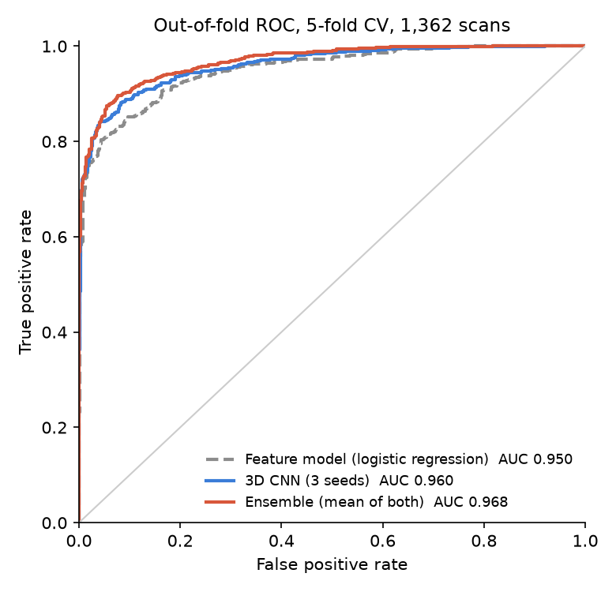
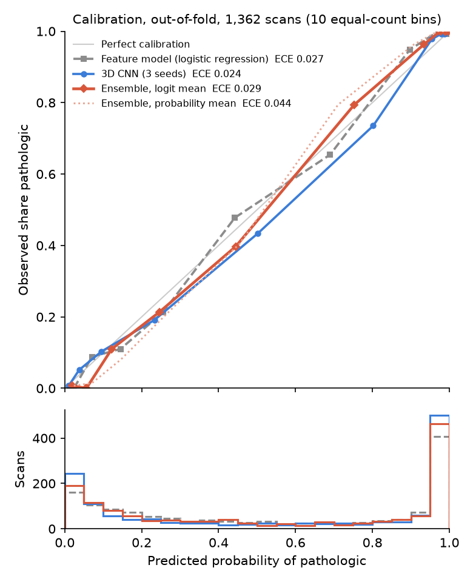

# datscan-parkinsons

Classifying DaT-SPECT brain scans as normal or pathologic (dopamine transporter loss, the imaging
sign of Parkinson's disease). The pipeline crops the striatum from each scan, puts every scanner on
the same intensity scale, and then compares two models: logistic regression on hand-built features,
and a small 3D CNN. Averaging the two gives an out-of-fold AUC of 0.968, log loss of 0.232 and
90.6% accuracy on 1,362 scans.

This started as an entry to DrivenData's
[DaT Parkinson's Prediction Challenge](https://www.drivendata.org/competitions/311/dat-parkinsons-challenge/).
My first attempt was in MATLAB and didn't work well. This is the rewrite, done as a personal project
after the competition closed.



## Data

The scans are not in this repo. They come from the challenge above, and you can download them from
its [data page](https://www.drivendata.org/competitions/311/dat-parkinsons-challenge/data/) after
signing up and accepting the competition rules. The training set has 1,362 NIfTI volumes
(`niftis_<suffix>/*.nii.gz`) and a CSV of binary labels (`train_labels_<suffix>.csv`, column
`is_pathologic`).

Extract both into one folder and either pass it with `--data-dir` or set `DAT_DATA_DIR`. By default
the scripts look in this repo's parent folder.

The scans are messy in ways that shaped the preprocessing. They come from different scanners, with
voxel sizes from 1.4 to 4.4 mm, matrix sizes from 128×128×33 up to 256³, and raw intensity maxima
ranging from 3 to about 18,000. About a quarter of them are stored with fewer than 64 distinct
integer values, and a few with only 4. Many also show bright structures that aren't the striatum:
salivary glands, the scalp, and ring artifacts from the camera.

## Setup

Python 3.12. Install PyTorch for your platform first (see [pytorch.org](https://pytorch.org)), then
the rest:

```bash
python -m venv .venv
.venv/Scripts/activate        # or: source .venv/bin/activate
pip install torch --index-url https://download.pytorch.org/whl/cu128
pip install -r requirements.txt
```

The CNN trains on a 6 GB laptop GPU (RTX 3060). It also runs on CPU, just much more slowly.

## Usage

Run the three steps in order. Each one reads what the previous one wrote to `output/`.

```bash
# 1. Preprocess: one crop, one sanity PNG and one manifest row per scan (~30 min for all scans)
python run_preprocess.py --n 16           # try a random sample first
python run_preprocess.py --all

# 2. Feature baseline: builds output/features.csv and runs repeated 5-fold CV
python baseline.py --scanner              # --scanner also runs the shortcut check below

# 3. 3D CNN, same folds as a refit logistic regression, plus the ensemble of both
python train_cnn.py --folds 1 --epochs 5  # quick smoke test
python train_cnn.py --seeds 3 --epochs 80
```

`python contact_sheet.py sheet.png <uid> <uid> ...` tiles sanity images into one picture, which is
the fastest way to review a batch of crops.

## How the preprocessing works

`preprocess.py` turns each raw scan into a 48×48×32 voxel crop (96×96×64 mm) around the striatum:

1. Reorient to RAS, crop to the head, resample to 2 mm voxels, and apply a 2 mm Gaussian. The
   smoothing evens out the differences between scanners and the heavily quantized files.
2. Build a head mask. Its threshold is relative to typical brain intensity rather than the brightest
   voxels, because the brightest voxels are the striatum itself and would make the mask depend on
   the signal being measured.
3. Find the striatum. The search runs over the inner head (eroded 20 mm), within 40 mm of the
   midline, and 55 to 125 mm below the top of the head when the top is in the field of view. Across
   all scans the striatum sits 87 ± 8 mm below the top, and this window is what keeps faint,
   severely affected striata from losing out to the skull base.
4. Divide by the mean of an occipital reference region 50 to 90 mm behind the striatum and subtract
   1. That gives a specific binding ratio (SBR) map, the same quantity clinicians read: background is
   about 0 and a healthy striatum is about 3 to 4, whatever the scanner.
5. Cut a fixed crop centred on the midline between the two striata. When one side is too dim to
   locate, the crop falls back to the head midline so it doesn't drift towards the bright side.

All 1,362 scans process without errors. 17 crops touch the edge of a short field of view and are
padded with 0, and one scan with very little brain coverage uses the median of the inner head as its
reference instead of the occipital region. `output/manifest.csv` flags both cases.

## Models and results

All numbers are out-of-fold over the full training set. Lower log loss is better. The first two
rows are reference points: always predicting the base rate (54.8% pathologic), and a model that
only sees scanner settings.

| Model | AUC | Log loss | Accuracy |
|---|---|---|---|
| Base rate, same prediction for every scan | 0.500 | 0.689 | 0.548 |
| Scanner settings only (shortcut check, XGBoost) | 0.746 | 0.589 | 0.678 |
| Logistic regression, 2 SBR features | 0.876 | 0.442 | 0.793 |
| Logistic regression, 20 features | 0.950 | 0.281 | 0.869 |
| XGBoost, 20 features | 0.947 | 0.289 | 0.872 |
| 3D CNN, 1 seed, 60 epochs | 0.958 | 0.259 | 0.884 |
| 3D CNN, 3 seeds, 80 epochs | 0.960 | 0.252 | 0.891 |
| Ensemble, mean of probabilities | 0.968 | 0.241 | 0.906 |
| Ensemble, mean of logits | 0.968 | 0.232 | 0.906 |

Both ensembles combine the 3-seed CNN with the 20-feature logistic regression.

The feature model (`baseline.py`) uses 20 features that don't depend on which side is affected:
SBR of the weaker and stronger striatum, left/right asymmetry, and per-side shape measured from the
crop (uptake in the anterior, middle and posterior thirds, the posterior/anterior ratio, elongation,
extent and volume). The most important single feature is posterior uptake on the weaker side, which
fits the clinical picture: dopamine loss in Parkinson's starts in the posterior putamen and moves
forward, so the comma-shaped striatum shrinks to a dot. The shape features are what take logistic
regression from 0.876 to 0.950.

The CNN (`train_cnn.py`) is small: four 3D conv blocks, global average pooling and dropout, 0.88M
parameters. Augmentation runs on the GPU. It flips left and right, rotates ±15° in the axial plane
and ±5° in the other two to cover head tilt, shifts by up to 4 voxels, scales by 0.92 to 1.08, and
multiplies intensity by 0.85 to 1.15 to cover differences between sites. Training runs for a fixed
number of epochs with no early stopping, so the held-out fold never influences which model is kept.
Predictions average each scan with its mirror image.

### Calibration



Log loss rewards probabilities that mean what they say, so I checked calibration as well as ranking.
Both single models are close to the diagonal, with an expected calibration error (ECE) of 0.024 for
the CNN and 0.027 for the feature model.

Averaging their probabilities makes the ensemble underconfident. When one model is sure and the
other less so, the mean lands in between: scans the ensemble rated about 7% were pathologic 1% of
the time, and scans it rated about 91% were pathologic 96% of the time (ECE 0.044). Averaging
log-odds keeps the confident predictions confident. That brings ECE down to 0.029 and log loss from
0.241 to 0.232, and AUC stays at 0.968 because the ranking barely changes. I chose the logit mean
after seeing these out-of-fold numbers, but it has nothing to fit, so the comparison is still fair.

The ensemble beats both models on its own because they get different scans wrong. The CNN reads the
whole 3D shape, and the feature model has more stable probabilities in the middle of the range.

### Confusion matrix

Logit-mean ensemble, out-of-fold, at a 0.5 threshold:

| | Predicted normal | Predicted pathologic | Total |
|---|---|---|---|
| Actually normal | 569 | 46 | 615 |
| Actually pathologic | 82 | 665 | 747 |
| Total | 651 | 711 | 1,362 |

That's a sensitivity of 0.890 (pathologic scans caught) and a specificity of 0.925 (normal scans
cleared). A pathologic prediction is right 93.5% of the time, a normal one 87.4%. Misses outnumber
false alarms, 82 to 46. The two models lean in opposite directions here: the CNN alone has the
higher sensitivity (0.905 vs 0.857), and the feature model the higher specificity (0.883 vs 0.875).
If missing a pathologic scan costs more than a false alarm, lowering the threshold trades some
specificity for sensitivity.

### Checks against misleading results

Scanner and acquisition settings alone predict the label with AUC 0.75, because the share of
pathologic scans varies by site. The models don't seem to lean on that: adding the scanner columns
to the feature model changes nothing (0.949 vs 0.949), and the ensemble's AUC stays between 0.93
and 0.99 within each of the seven main scanner groups.

The data has no patient IDs, so repeat scans of one patient could leak across folds. As a partial
check, no two crops correlate above 0.95, so there are no near-duplicates. Different scans of the
same patient taken at different times wouldn't be caught by this.

Of the ensemble's 128 errors in the confusion matrix, I looked at the most confident ones. In most of
them the label and the image disagree: scans labelled pathologic with normal comma shapes and high SBR, and scans labelled
normal with clearly reduced uptake. The labels are probably clinical diagnoses rather than reads of
the image, so some of the remaining error is likely a ceiling for any image-only model. Only one of
the confident errors came from a bad crop.

## Limitations

Head tilt isn't corrected. The crop is axis-aligned, so a strongly rotated head (one scan is turned
about 35°) gives an angled striatum. Augmentation covers moderate tilt, and registering every scan
to a template would fix it properly.

The results come from cross-validation on the public training set only. The competition's hidden
test set may have a different mix of scanners.

This is a learning project. It is not a medical device and shouldn't be used for diagnosis.

## Files

| File | What it does |
|---|---|
| `preprocess.py` | Scan to SBR crop, plus per-side features. Only needs numpy, scipy, nibabel and scikit-image. |
| `run_preprocess.py` | Batch runner: crops, sanity PNGs, `manifest.csv`, `failures.csv` |
| `baseline.py` | Shape features, feature model CV, scanner shortcut check |
| `train_cnn.py` | 3D CNN cross-validation, ensemble with the feature model |
| `contact_sheet.py` | Tiles sanity PNGs for quick review |

## License

The code is MIT licensed (see [LICENSE](LICENSE)). The dataset is not covered by this license and
stays under DrivenData's competition terms.
